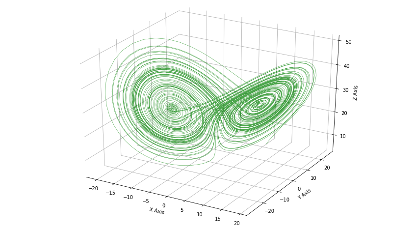
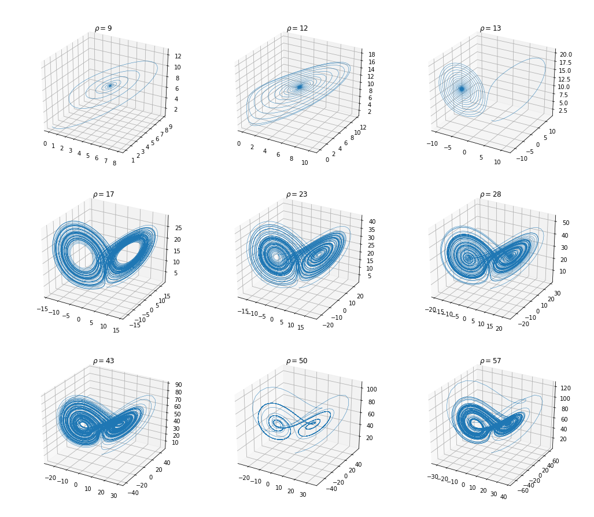

小さな蝶の羽ばたきが惑星全体を壊してしまう世界を想像してみてください。ばかげて聞こえますよね。けれども、そこには一片の真実があります。20世紀半ば、数学者エドワード・ローレンツは大気の対流を表す簡単な数理モデルを作りました。このモデルは、今日ローレンツ方程式として知られる三つの常微分方程式からなります。

$$
\begin{aligned}
\frac{dx}{dt} &= \sigma (y - x) \\
\frac{dy}{dt} &= x (\rho - z) - y \\
\frac{dz}{dt} &= x y - \beta z
\end{aligned}
$$

初期条件をほんの少し変えるだけで、まったく違う結果が出ます。しかも「少しずれる」のではなく、根本的に違う結果です。この振る舞いを*カオス*と呼び、多くの物理系が本質的に予測不可能である理由でもあります。

::: curious
ローレンツは1961年に偶然この現象を発見しました。印刷された6桁ではなく3桁に丸めた数値から気象シミュレーションを再開したところ、新しい結果は古い結果と完全に食い違ったのです。
:::

## 方程式を解く

最も簡単なオイラー法を使います。

$$y_{n+1} = y_n + h f(t_n, y_n)$$

$h$ は刻み幅です。ローレンツ方程式に適用すると：

```python
import numpy as np
import matplotlib.pyplot as plt

sigma, rho, beta = 10, 28, 8 / 3
h, t = 0.01, 10000

x = np.empty(t + 1); y = np.empty(t + 1); z = np.empty(t + 1)
x[0], y[0], z[0] = 10, 10, 10

for i in range(t):
    x[i + 1] = x[i] + h * (sigma * (y[i] - x[i]))
    y[i + 1] = y[i] + h * (x[i] * (rho - z[i]) - y[i])
    z[i + 1] = z[i] + h * (x[i] * y[i] - beta * z[i])

fig = plt.figure(figsize=(12, 9))
ax = fig.add_subplot(projection="3d")
ax.plot(x, y, z, color="g", alpha=0.7, linewidth=0.5)
plt.show()
```



## 初期条件への敏感さ

$10^{-5}$ だけ離れた三つの軌道は、数秒のシミュレーション時間で離れていきます。



::: tip
実際の計算には `scipy.integrate.solve_ivp` のRK45法を使ってください。オイラー法は考え方を理解するためのものです。
:::
