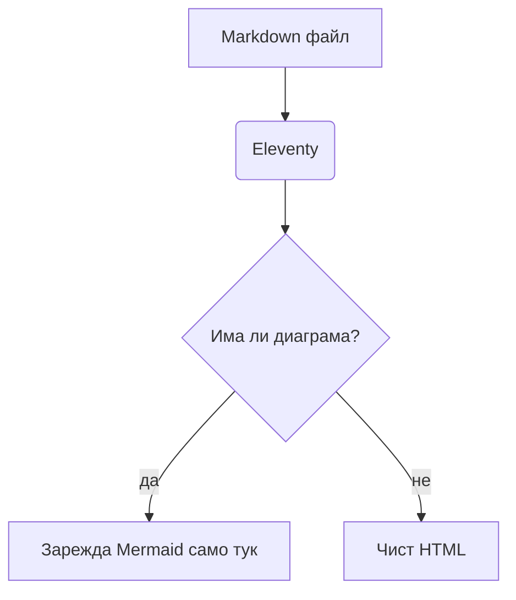

Това е пищовът, който ползвам, докато пиша. Всеки блок по-долу е обикновен Markdown с няколко shortcode-а; файлът е `src/content/blog/writing-guide_bg.md`.

## Специални секции

::: note
**Бележка**: нещо, което си струва да се запомни.
:::

::: tip
**Съвет**: практически трик.
:::

::: curious
**Любопитно**: интересен факт или странична история.
:::

::: warning
**Внимание**: лесно се бърка.
:::

::: danger
**Опасно**: загуба на данни, пари, безопасност.
:::

::: example Мое заглавие
Всяка секция може да има собствено заглавие след името ѝ.
:::

::: details Кликни, за да се разгъне
Скрито съдържание за дълги таблици или спойлери.
:::

## Формули

В текста $e^{i\pi} + 1 = 0$ и на отделен ред:

$$
\int_{-\infty}^{\infty} e^{-x^2}\,dx = \sqrt{\pi}
$$

## Диаграми и графики



```chart
{
  "type": "doughnut",
  "data": { "labels": ["Код", "Писане", "Рисуване", "Музика"], "datasets": [{ "data": [40, 25, 20, 15] }] }
}
```

## Код

```python
def greet(name: str) -> str:
    return f"Здравей, {name}!"
```

## Снимки, фигури и галерии





## Видео, YouTube и вграждания



{% iframe "https://www.openstreetmap.org/export/embed.html?bbox=23.30%2C42.19%2C23.34%2C42.22&layer=mapnik", { title: "OpenStreetMap", caption: "Произволен iframe в адаптивна рамка" } %}

## Карти









## Таблица със синтаксиса

| Блок | Синтаксис |
| --- | --- |
| Секция | `::: tip` … `:::` |
| Формула | `$…$` и `$$…$$` |
| Диаграма | ` ```mermaid ` |
| Графика | ` ```chart ` с JSON |
| Карта | `` |
| Галерия | `` |
