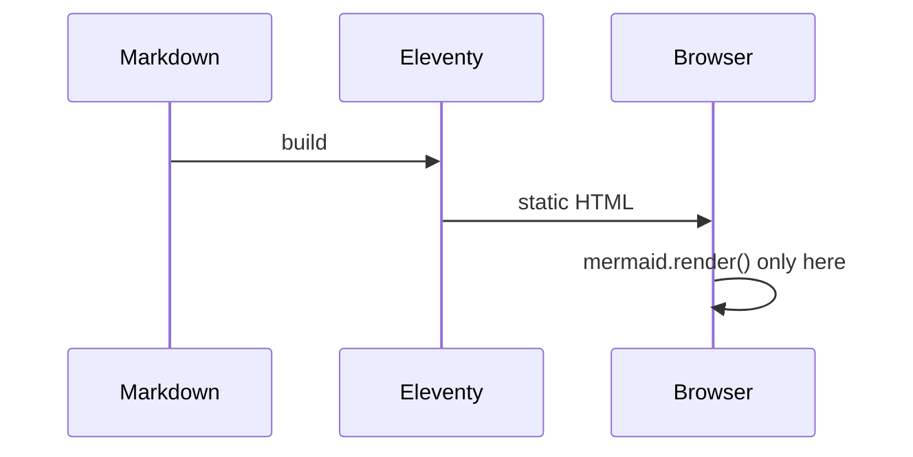

This post is the cheat sheet I use when writing. Every block below is written in plain Markdown with a few shortcodes; the source file is `src/content/blog/writing-guide_en.md`.

## Callouts

::: note
A **note**: something worth remembering.
:::

::: tip
A **tip**: a practical trick.
:::

::: curious
**Curious**: a fun fact or a side story.
:::

::: warning
A **warning**: easy to get wrong.
:::

::: danger
**Danger**: data loss, money, safety.
:::

::: example My own title
Any callout can have a custom title after its name.
:::

::: details Click to expand
Hidden content for long tables or spoilers.
:::

## Formulas

Inline $e^{i\pi} + 1 = 0$ and display:

$$
\int_{-\infty}^{\infty} e^{-x^2}\,dx = \sqrt{\pi}
$$

## Diagrams and charts



```chart
{
  "type": "bar",
  "data": { "labels": ["Mon", "Tue", "Wed", "Thu", "Fri"], "datasets": [{ "label": "Words written", "data": [320, 540, 120, 860, 410] }] }
}
```

## Code

```js
const greet = (name) => `Hello, ${name}!`;
console.log(greet("world"));
```

Keyboard: press <kbd>Ctrl</kbd> + <kbd>K</kbd>.

## Images, figures and galleries





## Video, YouTube and embeds



{% iframe "https://www.openstreetmap.org/export/embed.html?bbox=23.30%2C42.19%2C23.34%2C42.22&layer=mapnik", { title: "OpenStreetMap embed", caption: "Any iframe, in a responsive frame" } %}

<iframe src="https://www.openstreetmap.org/export/embed.html?bbox=23.56%2C42.17%2C23.60%2C42.19&layer=mapnik" title="Musala"></iframe>

## Cards









## Columns and tables

:::: columns
::: col
Left column text. Markdown works inside.
:::

::: col
Right column text with a list:
- one
- two
:::
::::

| Block | Syntax |
| --- | --- |
| Callout | `::: tip` … `:::` |
| Formula | `$…$` and `$$…$$` |
| Diagram | ` ```mermaid ` |
| Chart | ` ```chart ` with JSON |
| Map | `` |
| Gallery | `` |
