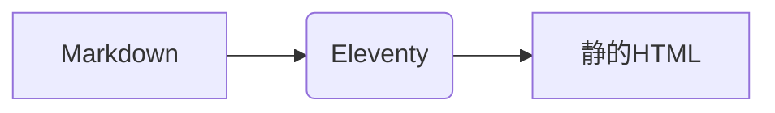

これは私が記事を書くときに使うチートシートです。以下のブロックはすべて普通のMarkdownといくつかのショートコードで書かれています。

## コールアウト

::: note
**メモ**：覚えておく価値のあること。
:::

::: tip
**ヒント**：実用的なコツ。
:::

::: curious
**豆知識**：面白い事実や脇道の話。
:::

::: warning
**注意**：間違えやすいこと。
:::

::: danger
**危険**：データ損失、お金、安全。
:::

::: details クリックで展開
長い表やネタバレのための隠しコンテンツ。
:::

## 数式

文中の $e^{i\pi} + 1 = 0$ と、独立した行：

$$
\int_{-\infty}^{\infty} e^{-x^2}\,dx = \sqrt{\pi}
$$

## 図とグラフ



```chart
{
  "type": "radar",
  "data": { "labels": ["コード", "執筆", "絵", "音楽", "旅"], "datasets": [{ "label": "今月", "data": [8, 6, 7, 5, 9] }] }
}
```

## 写真とギャラリー





## 動画と埋め込み



## カード






